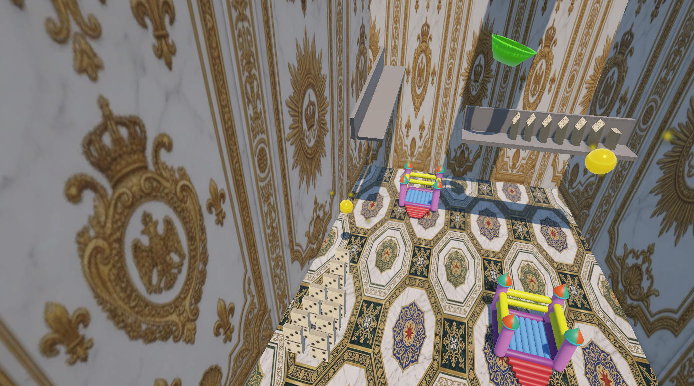

# ⚙️ Máquina de Rube Goldberg — Unity 6

Un proyecto de simulación física y reacción en cadena desarrollado en **Unity 6 (v6000.0.5f1)**. El objetivo principal es experimentar con el motor de físicas de Unity (`Rigidbody`, `Physics Materials` y `Colliders`) mediante la interacción de objetos mecánicos e inflables.

---

## Captura




## 📸 Elementos de la Máquina

La reacción en cadena consta de los siguientes pasos consecutivos:

1. **Rampas:** Una esfera se desplaza impulsada por la gravedad a lo largo de una serie de rampas inclinadas.
2. **Embudo:** La esfera entra al embudo, gira en espiral acelerando su trayectoria y cae directamente sobre el disparador del dominó.
3. **Efecto Dominó:** Caída en cadena de fichas de dominó mediante transferencia de cantidad de movimiento y colisiones físicas.
4. **Castillo Inflable:** La esfera impacta contra un castillo inflable, aprovechando un material físico con alta restitución (rebote).

---

## 🛠️ Requisitos e Instalación

### Requisitos
* **Unity Hub**
* **Unity 6000.0.5f1** (Unity 6)

### Instrucciones

1. **Clonar el repositorio:**
   ```bash
   git clone [https://github.com/garcialuisf/rube-goldberg-machine](https://github.com/garcialuisf/rube-goldberg-machine)
